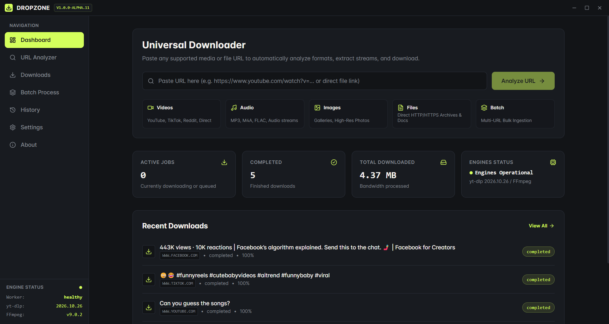

<p align="center">
  
</p>

<h1 align="center">DROPZONE</h1>

<p align="center">
  <strong>Universal Desktop Download Manager for Windows</strong>
</p>

<p align="center">
  <a href="https://get-drop-zone.vercel.app/"></a>
  <a href="LICENSE"></a>
  
  
  
  
</p>

<p align="center">
  A free, open-source Windows download manager for media and files. Inspect streams, download, organize, batch process, and convert content with a fast, private, local-first interface.
  <br /><br />
  <a href="https://get-drop-zone.vercel.app/"><strong>🌐 Official Website</strong></a> &bull;
  <a href="https://get-drop-zone.vercel.app/#showcase"><strong>🖥️ Live Showcase</strong></a> &bull;
  <a href="https://github.com/hasnizihar/DropZone/releases/latest"><strong>⬇️ Download Latest Release</strong></a> &bull;
  <a href="docs/INSTALLATION.md"><strong>📖 Documentation</strong></a>
</p>

---

## Download DROPZONE

Official release binaries for Windows (64-bit) are available directly from the [GitHub Releases](https://github.com/hasnizihar/DropZone/releases) page:

| Package Type | Version | Direct Asset Link | Description |
| :--- | :--- | :--- | :--- |
| **Windows Installer** | `1.0.0-alpha.12` | [DROPZONE-Setup-1.0.0-alpha.12-x64.exe](https://github.com/hasnizihar/DropZone/releases/latest) | Full setup wizard with Desktop & Start Menu shortcuts. Safe updates and uninstallation. |
| **Portable Executable** | `1.0.0-alpha.12` | [DROPZONE-Portable-1.0.0-alpha.12-x64.exe](https://github.com/hasnizihar/DropZone/releases/latest) | Zero-install standalone binary. Runs immediately with no administrator privileges needed. |

> [!TIP]
> **Verifying Checksums**: Cryptographic SHA-256 hashes for all official packages are published in [docs/RELEASE_CHECKSUMS.md](docs/RELEASE_CHECKSUMS.md). You can verify your download in PowerShell with `Get-FileHash -Algorithm SHA256 <filename>`.

---

## Why DROPZONE?

Most download utilities are bloated, ad-ridden, or stream user activity to cloud servers. DROPZONE is engineered around a different philosophy:

- **100% Local-First & Private**: Zero remote telemetry, zero third-party analytics, and zero required user accounts. Your download queue, history, and preferences stay strictly on your machine in a local SQLite database (`dropzone.db`).
- **Deep Format Inspection**: Paste any video or stream URL to inspect available resolutions (4K, 1440p, 1080p, 720p), video bitrates, audio codecs, and file sizes before initiating a download.
- **Dual-Engine Architecture**: Seamlessly handles direct HTTP/HTTPS files with pause/resume and chunked transfers, alongside rich streaming media powered by a self-contained companion worker (`yt-dlp` & `gallery-dl`).
- **Batch & Playlist Ingestion**: Ingest complete media playlists (up to 200 items) or batch queues of up to 50 URLs via plain text or CSV import, with parallel analysis and per-item controls.
- **Audio Conversion & Remuxing**: Convert video to pure audio (MP3, M4A, FLAC, WAV, OPUS) with selectable bitrates (128k to 320k) or remux video containers (MP4, MKV, WebM) on the fly using FFmpeg.
- **Crash Recovery & Queue Resilience**: If your system reboots or the application crashes, active and pending downloads are preserved in SQLite and restored automatically on next launch.

---

## Visual Tour & Screenshots

DROPZONE features an intentionally restrained, high-contrast dark aesthetic built with official brand tokens:
- **Near Black** (`#121417`): Deep surface canvas for fatigue-free viewing.
- **Warm Off-White** (`#F5F3EF`): High-contrast typography and clear metadata readouts.
- **Acid Lime** (`#D4FF5C`): High-visibility accents, progress bars, and primary actions.

<p align="center">
  
  <br />
  <em>DROPZONE Dashboard — Real-time engine health, instant URL input bar, and activity overview.</em>
</p>

> [!TIP]
> **Interactive Preview**: You can explore all 7 primary application views interactively with live state toggles on the [Official Landing Page Showcase](https://get-drop-zone.vercel.app/#showcase).

### Interface Gallery

| View | Local Capture | Interactive Web Preview | Description |
| :--- | :--- | :--- | :--- |
| **URL Analyzer** | [screenshot-analyzer.png](docs/images/screenshot-analyzer.png) | [View in Showcase](https://get-drop-zone.vercel.app/#showcase) | Inspect media streams, audio codecs, bitrates, and video resolutions before starting. |
| **Download Queue** | [screenshot-queue.png](docs/images/screenshot-queue.png) | [View in Showcase](https://get-drop-zone.vercel.app/#showcase) | Active progress indicators in Acid Lime, speed readouts (MB/s), ETA, and pause/resume. |
| **Batch Downloader** | [screenshot-batch.png](docs/images/screenshot-batch.png) | [View in Showcase](https://get-drop-zone.vercel.app/#showcase) | Ingest multi-URL playlists, text files, and bulk queues with categorized detection. |
| **Download History** | [screenshot-history.png](docs/images/screenshot-history.png) | [View in Showcase](https://get-drop-zone.vercel.app/#showcase) | Searchable SQLite database of completed downloads with quick "Open Folder" action. |
| **Settings** | [screenshot-settings.png](docs/images/screenshot-settings.png) | [View in Showcase](https://get-drop-zone.vercel.app/#showcase) | Concurrency limit, default audio extraction formats (MP3/FLAC), and FFmpeg path config. |
| **About View** | [screenshot-about.png](docs/images/screenshot-about.png) | [View in Showcase](https://get-drop-zone.vercel.app/#showcase) | Version information, license terms, and bundled engine status. |

For the full visual capture checklist, screen dimensions, and reference specifications, see [docs/SCREENSHOTS.md](docs/SCREENSHOTS.md).

---

## Quick Start (3-Step Walkthrough)

1. **Add Download**:
   Paste any media or file URL into the top search bar, or navigate to **Batch** to paste multiple links.
2. **Choose Format & Quality**:
   Review extracted streams in the **Analyzer**. Choose your desired video resolution, select "Audio Only" extraction, or configure custom container conversion.
3. **Download & Manage**:
   Track download speeds (MB/s), downloaded bytes, and ETAs in the **Downloads** queue. Access completed files anytime in **History** or reveal them directly in Windows File Explorer.

---

## System Requirements & Prerequisites

### Supported Operating System
- **Windows 10 / Windows 11 (64-bit)**.

### Bundled Standalone Python Worker
DROPZONE bundles a self-contained Python 3.12 companion worker (`dropzone-worker.exe`) that packages `yt-dlp`, `gallery-dl`, `requests`, and `psutil`. **You do not need to install Python on your computer.**

### External FFmpeg Setup
FFmpeg is required for merging audio/video streams, extracting audio tracks (MP3/FLAC), and remuxing video containers. Because FFmpeg is an external system tool, DROPZONE adheres to standard open-source distribution practices by discovering system-installed FFmpeg rather than distributing a modified binary:

1. **Recommended (WinGet)**:
   Open PowerShell or Terminal and run:
   ```powershell
   winget install Gyan.FFmpeg
   ```
2. **Manual Installation**:
   Download FFmpeg from [gyan.dev](https://www.gyan.dev/ffmpeg/builds/) or [ffmpeg.org](https://ffmpeg.org/), extract it, and either add its `bin` folder to your system `PATH`, or place `ffmpeg.exe` and `ffprobe.exe` into:
   ```
   %APPDATA%\DROPZONE\resources\ffmpeg\
   ```
   DROPZONE automatically detects FFmpeg on startup and displays its status on the Dashboard and Settings pages.

---

## Windows SmartScreen, Smart App Control & Code Signing

DROPZONE release builds are created with official publisher metadata (`Hz Creatives`).

### Standard Windows Defender SmartScreen
Because DROPZONE is an independent open-source project without a costly commercial Extended Validation (EV) certificate, Windows Defender SmartScreen may display an *"Unknown Publisher"* warning on first launch:
1. Click **More info**.
2. Click **Run anyway**.

### Windows 11 Smart App Control (Error 4551)
On newer Windows 11 systems with **Smart App Control (SAC)** set to **Enforced**, Windows uses kernel-level application control policies that block any unsigned executable or installer child processes (`Setup.tmp`) with:
```
Error 4551: An Application Control policy has blocked this file.
```
- **For Developers & Local Testers**: Smart App Control enforcement state can be managed in **Windows Security** &rarr; **App & browser control** &rarr; **Smart App Control**.
- **For Production Releases**: Full commercial code-signing architecture (using cloud HSM via SSL.com eSigner or Certum SimplySign) is documented in the forensic audit [Plan/WINDOWS_CODE_SIGNING_DIAGNOSIS.md](file:///D:/INDEX/DropZone/Plan/WINDOWS_CODE_SIGNING_DIAGNOSIS.md) and [docs/WINDOWS_SIGNING_GUIDE.md](docs/WINDOWS_SIGNING_GUIDE.md).

---

## Project Structure

DROPZONE is organized as a clean npm workspace monorepo:

```
dropzone/
├── apps/
│   └── desktop/                  # Electron + React + Vite + Tailwind desktop application
│       ├── electron/             # Main process, secure preload, IPC channels
│       │   └── database/         # SQLite persistence layer (sql.js WASM + migrations)
│       ├── src/                  # React UI, Zustand state stores, views, and pages
│       └── resources/            # Application icons, artwork, and worker binaries
├── packages/
│   └── shared/                   # Shared TypeScript domain contracts, Zod schemas, IPC types
├── backend/
│   ├── worker/                   # Standalone Python 3.12 worker (yt-dlp, gallery-dl)
│   └── tests/                    # Pytest suite for worker & engine fault-injection
├── website/                      # Official landing page (React 18 + Vite 6 + Tailwind CSS)
│   ├── src/                      # Landing page components, hero, showcase, FAQ
│   └── public/                   # Web assets, brand icons, and application screenshots
├── installer/                    # Inno Setup 6 compiler script (.iss) and installer graphics
├── scripts/                      # Build automation, worker compilation, and packaging helpers
├── docs/                         # Architecture documentation, signing guide, checksums
└── .github/                      # Issue templates, PR template, CI workflows
```

---

## Developer Quick Start

If you want to build or contribute to DROPZONE locally:

### Prerequisites
- [Node.js](https://nodejs.org/) >= 20.x
- [Python](https://www.python.org/) >= 3.10 (for backend development)
- [FFmpeg](https://ffmpeg.org/) (for post-processing)

### Development Setup
```bash
# Clone the repository
git clone https://github.com/hasnizihar/DropZone.git
cd DropZone

# Install Node dependencies across workspaces
npm install

# Run the desktop application in development mode
npm run dev

# Run the marketing landing page in development mode
npm run website:dev
```

### Running Test Suites
```bash
# Run Vitest unit & integration tests
npm test

# Run Python worker test suite
npm run test:python

# Run Electron runtime smoke test
npm run smoke:electron

# Run Packaged binary smoke test
npm run smoke:packaged
```

### Packaging & Web Builds
```bash
# Build marketing landing page for production
npm run website:build

# Compile standalone Python companion worker
npm run build:worker

# Package Windows NSIS installer
npm run package:win

# Package Windows portable executable
npm run package:portable

# Package both distributions
npm run package:all
```

---

## Contributing & Security

- **Contributing**: We welcome bug reports, improvements, and pull requests! Please read [CONTRIBUTING.md](CONTRIBUTING.md) for development rules, commit conventions, and submission processes.
- **Security Vulnerabilities**: For responsible disclosure of potential security vulnerabilities, please refer to [SECURITY.md](SECURITY.md).

---

## License & Third-Party Acknowledgements

DROPZONE is open-source software licensed under the **[MIT License](LICENSE)**:

```
Copyright (c) 2026 Hz Creatives (KR Hasni Zihar)
```

### Third-Party Software & Companion Engines
DROPZONE interfaces with and bundles several outstanding open-source projects, including Electron, React, `yt-dlp`, `gallery-dl`, `requests`, `psutil`, `sql.js`, and `FFmpeg`. Each component retains its original open-source license. Complete license texts, copyright attributions, and source access instructions are detailed in **[THIRD_PARTY_NOTICES.md](THIRD_PARTY_NOTICES.md)**.

### Responsible Use Notice
The MIT License grants rights to the DROPZONE software itself. It does not grant rights to download, convert, or distribute copyrighted or restricted content without authorization from the respective rights holder. Users are solely responsible for ensuring their usage complies with all applicable laws and third-party terms of service.
