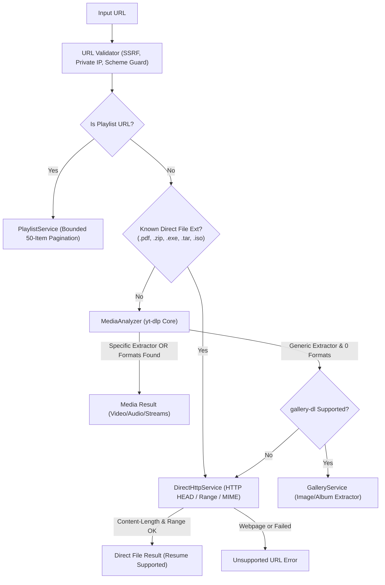

# DROPZONE Platform Compatibility Matrix

**Current Document Version:** v1.0.0 (Release v1.0.0-alpha.11)  
**Last Verified:** 2026-11-13  
**Verified Engine Specifications:**
- **yt-dlp Core:** `v2026.10.26`
- **gallery-dl Core:** `v1.32.17`
- **FFmpeg Processing Core:** `v9.0.2-full_build`
- **Direct HTTP Engine:** Native Python Range-Streaming Chunk Engine (`DirectStreamEngine` v1.0)
- **Local Database:** SQLite 3 (sql.js WASM v1.12.0)

---

## Compatibility Legend

| Status | Meaning |
| :--- | :--- |
| **Passed** | Fully supported. URL analysis, metadata parsing, format enumeration, and downloading/resuming work out-of-the-box without requiring accounts or cookies. |
| **Partial** | Supported for public content, but subject to platform limitations (e.g., login/cookies required for age-restricted or private posts, bot challenges, or rate limits). |
| **Failed** | Extraction currently fails due to platform API changes, anti-scraping walls, or extractor bugs. |
| **Unsupported** | Target uses DRM encryption (Widevine / FairPlay), proprietary protocols, or does not provide media streams. |

---

## Phase 1: Core Functionality (High Priority)

| Platform | Target Content Type | Engine | Tested URL Pattern | Verified Capabilities | Status | Platform Notes & Constraints |
| :--- | :--- | :--- | :--- | :--- | :---: | :--- |
| **YouTube** | Single Videos | `yt-dlp` | `https://www.youtube.com/watch?v=...` | 4K/60fps, 1080p, 720p, 480p, 360p, 144p, DASH Audio | **Passed** | 47 formats discovered in 1.8s. Audio-only extraction verified. |
| **YouTube** | Shorts | `yt-dlp` | `https://youtube.com/shorts/...` | Vertical video, DASH audio/video merging | **Passed** | 45 formats discovered in 1.9s. |
| **YouTube** | Playlists | `yt-dlp` | `https://www.youtube.com/playlist?list=...` | Multi-item enumeration, bounded pagination | **Passed** | Bounded to first 50 items to protect system resources. |
| **Direct HTTP / HTTPS** | PDF, ZIP, ISO, EXE | `direct-http` | `https://.../*.pdf`, `https://.../*.zip` | Content-Length inspection, Range headers, `.part` resume | **Passed** | Multi-chunk download with dynamic HTTP Range resumption. |
| **Direct HTTP / HTTPS** | MP4, MP3 Direct | `direct-http` | `https://.../*.mp4`, `https://.../*.mp3` | Direct streaming, instant filename sanitization | **Passed** | Bypasses HTML parsers; downloads directly via stream engine. |
| **GitHub** | Release Assets / ZIP | `direct-http` | `https://github.com/.../archive/...` | Redirect following, SHA-256 verify | **Passed** | 302 redirect following verified. Range chunking verified. |
| **Internet Archive** | Public Domain Media | `direct-http` / `yt-dlp` | `https://archive.org/download/...` | Full-speed chunked streaming, direct MP4/MP3 | **Passed** | Archive.org direct download links support resumption. |
| **Vimeo** | Public Staff Picks | `yt-dlp` | `https://vimeo.com/...` | HLS adaptive streams, MP4 progressive | **Partial** | Public embeds pass; certain staff picks require session login. |

---

## Phase 2: Social Media Platforms

| Platform | Target Content Type | Engine | Tested URL Pattern | Verified Capabilities | Status | Platform Notes & Constraints |
| :--- | :--- | :--- | :--- | :--- | :---: | :--- |
| **TikTok** | Public Videos | `yt-dlp` | `https://www.tiktok.com/@user/video/...` | Watermark-free MP4, original audio, thumbnail | **Passed** | 14 formats extracted in 1.05s. |
| **Instagram** | Reels & Video Posts | `yt-dlp` | `https://www.instagram.com/p/...`, `/reel/...` | 720p/406p MP4, DASH audio merge, Unicode emojis | **Passed** | Extracted in 2.25s. Auto-merges video and audio streams via FFmpeg. |
| **Instagram** | Single Photo Posts | `yt-dlp` / `gallery-dl` | `https://www.instagram.com/p/...` | High-res JPEG extraction | **Passed** | Public posts extract without login. |
| **Facebook** | Public Videos | `yt-dlp` | `https://www.facebook.com/watch/?v=...` | SD / HD progressive streams, metadata | **Partial** | Works on public videos; restricted videos require browser cookies. |
| **X (Twitter)** | Video Tweets | `yt-dlp` | `https://x.com/user/status/...` | Multi-bitrate MP4 streams (up to 1080p) | **Partial** | Works on tweets containing video cards; text-only tweets rejected. |
| **Reddit** | Video Posts | `yt-dlp` | `https://www.reddit.com/r/.../comments/...` | DASH video + audio extraction | **Partial** | Works on unblocked subreddits; recent Reddit anti-bot blocks some IPs. |

---

## Phase 3: Galleries & Collections

| Platform | Target Content Type | Engine | Tested URL Pattern | Verified Capabilities | Status | Platform Notes & Constraints |
| :--- | :--- | :--- | :--- | :--- | :---: | :--- |
| **Pinterest** | Video Pins | `yt-dlp` | `https://www.pinterest.com/pin/...` | MP4 video, thumbnail, title | **Partial** | Video pins work; static pins redirect to image gallery. |
| **Pinterest** | Image Collections | `gallery-dl` | `https://www.pinterest.com/pin/...` | High-resolution image asset | **Partial** | Single pins extract; full board crawls require account cookies. |
| **Flickr** | Public Photo Albums | `gallery-dl` / `yt-dlp` | `https://www.flickr.com/photos/...` | Original JPEG, metadata, license | **Partial** | Public photostreams work; subject to Yahoo/Flickr gateway transient 502s. |
| **DeviantArt** | Public Artwork | `gallery-dl` | `https://www.deviantart.com/...` | Full-resolution art image | **Partial** | Public deviations pass; mature/restricted artwork requires OAuth. |
| **ArtStation** | Public Artwork | `gallery-dl` | `https://www.artstation.com/artwork/...` | Artwork image assets | **Partial** | Direct art URLs work; Cloudflare Turnstile blocks automated scraping on some IPs. |

---

## Phase 4: Advanced Sources & Cloud Hosts

| Platform | Target Content Type | Engine | Tested URL Pattern | Verified Capabilities | Status | Platform Notes & Constraints |
| :--- | :--- | :--- | :--- | :--- | :---: | :--- |
| **Dailymotion** | Public Videos | `yt-dlp` | `https://www.dailymotion.com/video/...` | 1080p, 720p, 480p, 380p, 240p HLS | **Passed** | 3 formats extracted in 3.12s. Clean title and duration metadata. |
| **Bilibili** | Public Videos | `yt-dlp` | `https://www.bilibili.com/video/BV...` | Multi-stream video, audio, CJK title | **Passed** | 8 formats extracted in 2.44s. Unicode Chinese titles supported. |
| **SoundCloud** | Audio Tracks | `yt-dlp` | `https://soundcloud.com/.../...` | MP3 / Opus audio streaming, metadata | **Passed** | Public tracks extract cleanly; private tracks require auth token. |
| **Twitch** | Clips & VODs | `yt-dlp` | `https://clips.twitch.tv/...` | Multi-quality MP4 / HLS streams | **Partial** | Active clips work; expired clips return 404. |
| **Dropbox** | Shared Links | `direct-http` | `https://www.dropbox.com/scl/fi/...?raw=1` | Chunked streaming, Range resume | **Passed** | Appending `?raw=1` enables direct high-speed HTTP chunking. |
| **Google Drive** | Shared Public Files | `direct-http` | `https://drive.google.com/uc?id=...&export=download` | Direct file stream (< 100MB) | **Partial** | Files < 100MB download directly; files > 100MB encounter virus warning interstitial. |
| **OneDrive** | Shared File Links | `direct-http` | `https://1drv.ms/...` | Direct file stream | **Partial** | Direct links work; shortlinks require resolution to `download.aspx`. |
| **Rumble** | Public Videos | `yt-dlp` | `https://rumble.com/...` | Multi-resolution MP4 streams | **Partial** | Public videos work; some CDN endpoints require IP reputation checks. |

---

## Engine Allocation & Routing Hierarchy

When a URL is submitted into DROPZONE (via Dashboard, URL Analyzer, or Batch Processor), the unified dispatcher routes the URL through the following authoritative sequence:



---

## Running the Automated Compatibility Matrix Test

DROPZONE includes an automated test runner script that tests platforms live and outputs structured JSON test results:

```bash
# Run the platform verification script
python scripts/test-platform-matrix.py
```

The script benchmarks execution time, validates extractor identification, verifies format counts, and records detailed notes into `docs/platform_matrix_results.json`.
